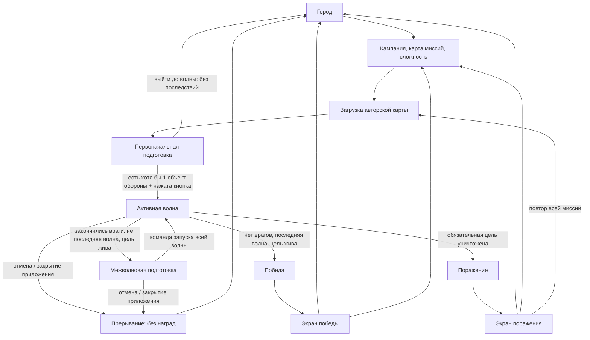

# 02 — Кампания: миссия, боевая экономика и контракты

**Статус:** P02/P03 качественно утверждены (`GD-DEC-003…033`; старые `REQ-P02-01…20`, `P03-R01…29`); числа P10, UX P16, сохранения P18. **В этом файле единый источник правил боевой валюты, контрактов и машины состояний.**

## A. Экономика внутри миссии (P02)

**Источники:** ответы автора на пакет `P02-01…P02-14`, `GD-DEC-001…029`.  
**Принцип:** это рабочая геймдизайнерская спецификация, не задание на внедрение без отдельного DoR.

## 1. Экономические контуры и термины

В городе существуют **постоянные разблокировки** обычных/улучшенных/элитных воинов и ловушек; самих экземпляров в городском запасе нет. В миссии изученные типы размещаются за **припасы** (временный бюджет данной миссии). **Наёмники** имеют дополнительно ограниченные контракты в постоянном запасе игрока; один контракт оплачивает первое участие одного конкретного отряда наёмников в текущей миссии. **Ресурс перезарядки ловушек** — другой временный боевой ресурс; официальное название ещё не утверждено. Он не используется на воскрешение юнитов.

| Ресурс / состояние | Где существует | Начало миссии | Пополнение | Срок жизни |
|---|---|---|---|---|
| Припасы размещения | Текущая миссия | Задано данными миссии; количество P10 | Фиксированная награда по данным за завершённую волну и возвраты при продаже | Не переходят между миссиями, остаток пропадает |
| Ресурс перезарядки | Текущая миссия | **Ровно 0** | За убийство допустимого вражеского юнита, по награде его типа; призванные врагами существа не дают ресурс | Накапливается между волнами, не переносится между миссиями |
| Неиспользованные контракты наёмников | Постоянный профиль | Имеющийся запас игрока | **P14:** награды миссий/событий, покупка за золото после индивидуальных условий открытия | Сохраняются между миссиями до первого оплаченного участия; без геймплейного лимита накопления |
| Активированный экземпляр наёмника | Только текущая миссия | Отсутствует | При первом запуске волны с новым размещённым наёмником | Сохраняется до окончания текущей миссии, в том числе после продажи со слота |

**P10 утверждено:** убийство **обычного гоблина даёт ровно 1 единицу** ресурса перезарядки. Пример «огр = 4 либо 6» остаётся `TBD`, потому что автор не задал награду за огра. Название валюты не утверждено. По умолчанию после каждой **нефинальной** волны начисляется **10 припасов**, но авторская конфигурация каждой миссии/волны может установить другое значение. Стартовые припасы задаются **каждой миссией**, общей обязательной суммы нет.

## 2. Фазы и операции

Первоначальная подготовка и межволновая подготовка имеют **одинаковые** права на размещение, покупку за припасы, продажу и замену объектов **только по схеме «продать → выбрать новый свободный совместимый слот → разместить заново»**. **Прямое перемещение/перетаскивание уже размещённой обороны между слотами запрещено даже во время подготовки (уточнение P16-Q08)**. В активной волне **нет** размещения, продажи, перестановки или замены. В ней доступны применение заклинаний, способности героев, **бесплатное** ручное воскрешение юнита после отката и **платная** ручная перезарядка сработавшей ловушки. Других исключений нет. Допустимых операций в подготовке можно совершать сколько угодно, без налога, лимита количества действий и дополнительного штрафа.

Точные переходы фаз, пауза, досрочный старт, прерывание и завершение последней волны оформляются в P03. UI-команды и блокировки — P16.

## 3. Припасы: начисление и продажа

- Начальная сумма припасов **индивидуальна для миссии**; универсальной цены стартовой обороны или обязательного бюджета первой волны нет.
- После завершения каждой **нефинальной** волны выдаётся **фиксированное для этой волны количество** припасов из её конфигурации. **Значение по умолчанию — 10 припасов**, допускается авторское переопределение в любой миссии/волне. Ни число убийств, ни эффективность, ни остаток HP защищаемой цели выплату не меняют. После финальной волны межволновой выплаты нет.
- Остаток припасов **неограниченно накапливается в пределах одной миссии**; ограничения потолка пользователь не требует. После завершения/отмены/перезапуска миссии старый остаток не переходит в новую попытку; каждая попытка получает новый стартовый бюджет.
- При допустимой продаже любого не-наёмного юнита (в том числе героя) возвращается **ровно 100% суммы припасов**, уплаченной за его текущее размещение. Стоимость во время миссии не меняется, скидок и надбавок нет.
- То же правило 100% относится к **заряженной** ловушке и **наёмнику**. Продажа возвращает только припасы размещения, **не** израсходованный контракт и **не** ресурс предыдущих перезарядок ловушки.
- При ошибочной или повторной операции ни припасы, ни слоты, ни контракты не должны измениться. Частичная транзакция недопустима (техническая реализация — P18).

## 4. Обычные юниты и герои

**Утверждено P10:** обычные войска разных рангов размещаются за **одинаковую стоимость припасов**, несмотря на разную силу (включая прямо приведённый пример «крестьянин с вилами / элитный гвардеец»). Это правило стоимости **размещения**, не стоимости городского исследования. Для героя отдельный ориентир **примерно 12–15 припасов**, пока не утверждена точная стоимость конкретного героя.

У всех обычных, улучшенных и элитных юнитов нет постоянных поштучных экземпляров. Размещённого юнита можно продать в подготовке и повторно поставить за припасы. Герой **является юнитом**, стоит в общем слоте для юнитов и подчиняется всем правилам продажи, здоровья, смерти и восстановления. **Никакого индивидуального опыта, прогрессии героя внутри миссии или прокачки экземпляра нет.** Улучшения обычных типов юнитов происходят в городской метапрогрессии. **Герои имеют собственные постоянные уровни и отдельные улучшения оружия/брони/способности в таверне (P07)**, но не получают опыт или новые уровни **внутри миссии**.

Во время активной волны погибший юнит ждёт откат; после отката по клику **бесплатно** возвращается с полным HP. В конце волны **все** юниты, включая героев и наёмников, автоматически живы с полным HP: без ожидания, кликов, валют и списания контрактов. Точное время отката — P03/P10.

## 5. Наёмники: контракт и повторное размещение

### 5.1. До первого участия

Контракты можно получить как награду за миссию/событие или приобрести за золото; у видов наёмников индивидуальные условия открытия. **Нет общего игрового предела накопления контрактов.**

При размещении нового наёмника до запуска волны контракт лишь **резервируется** из доступного постоянного запаса, не расходуется. Снятие/продажа до старта волны возвращает уплаченные припасы и освобождает резерв без списания контракта. В меню размещения **только у наёмников показывается количество**: у остальных юнитов такого счётчика нет. Отдельное предупреждение при продаже уже оплаченного наёмника не нужно.

### 5.2. Впервые участвует в волне

При первом запуске волны с конкретным ранее не участвовавшим наёмником соответствующий контракт **окончательно списывается ровно один раз**. Этот отряд может сражаться на протяжении **всей текущей миссии**, переживать смерть и воскрешения, менять позиции. Следующие старты волн для того же экземпляра не тратят новый контракт.

### 5.3. Продажа после участия и повторное выставление

При допустимой межволновой продаже наёмника возвращается **100% его припасов размещения**, слот освобождается. Его **контракт не возвращается**. При этом уже активированный отряд **остаётся доступным внутри текущей миссии** для повторного размещения без нового контракта. Для учёта достаточно внутреннего набора/списка ранее активированных экземпляров; **отдельный экран резерва не нужен**.

При повторном размещении наёмника соответствующего типа система **сначала использует доступный уже активированный экземпляр**, не запрашивая новый контракт. Если уже активированных свободных экземпляров нет и игрок размещает ещё один, резервируется **следующий контракт** из постоянного запаса; он списывается при первом запуске волны с новым отрядом. Нельзя использовать один и тот же активированный отряд сразу в двух слотах.

### 5.4. Конец миссии и рестарт

Когда миссия заканчивается, все её временные/ранее активированные отряды перестают быть доступны. Невыставленный после продажи активированный наёмник **также исчезает**; затраченный контракт не возвращается. Отдельное предупреждение не требуется. Победа, поражение и добровольный рестарт после начала участия **не возвращают** контракт. Отмена миссии **до запуска первой волны** не расходует ни один зарезервированный контракт. Если любой новый наёмник впервые вступает в бой на более поздней волне, списание происходит при запуске именно этой волны.

### 5.5. Пример (иллюстрация, не баланс)

Игрок имел 5 контрактов типа М. До первой волны разместил одного → резерв 1, расход 0. Старт волны → 4 контракта, 1 активированный М. После волны продал М → вернул припасы, слот свободен, **4 контракта**, активированный М остаётся внутри миссии. Снова выставил М → припасы потрачены, **4 контракта**. Выставил второго М → резерв 1 дополнительного контракта, после старта следующей волны остаётся **3 контракта**. Если первый М больше не нужен, после окончания миссии он исчезает, но четвёртый контракт не вернётся.

## 6. Ловушки — единый нормативный источник

Новая ловушка появляется с полным числом зарядов (обычно 2–3, индивидуальная настройка), срабатывание расходует один заряд. Ручная платная **полная** перезарядка только при нуле после завершения цикла. Межволновый переход заряды не восстанавливает; прямого перемещения ловушки между слотами нет (P16). Продажа возможна **только при `remaining == max`**, возврат припасов 100%; потраченный ресурс перезарядки не возвращается. Полный автомат ловушки и UI — `05-traps-and-towers.md` (`GD-DEC-069…082`).

## 7. Ресурс перезарядки за убийства

- На старте любой миссии/новой попытки ресурс = **0**. **P10:** убийство базового гоблина (`FK-GOBLIN`) приносит **1 единицу**; для других типов награда остаётся индивидуальной конфигурацией (`TBD`).
- Начисляется за **каждое реальное убийство** допустимого вражеского юнита, **независимо от источника убийства** (бойцы, герои, магия, ловушки, башни, иные причины гибели).
- Враг, дошедший до защищаемой цели живым, **не убит**, награды нет.
- **Призванные противником существа НЕ дают этот ресурс**, даже если погибли. Это явное исключение к правилу «за все убийства».
- Одно событие уничтожения даёт выплату не более одного раза. Для остальных врагов размер награды задаётся по типу противника и пока `TBD`; не выводить её из размера или класса врага автоматически.
- Ресурс **копится между волнами** и **не переносится в другие миссии**. Пользователь отдельно не утвердил численный потолок этого ресурса; не придумывать его автоматически, численные ограничения, если понадобятся, оценить при P10.
- Дополнительные источники, кроме убийств, не определены и **не допускаются как утверждённые правила**.

## 8. Экономические инварианты

1. Баланс припасов и ресурса ловушек не становится отрицательным; операция при нехватке средств отклоняется.
2. Продажа допустимого объекта возвращает сумму уплаченных за его **текущее** размещение припасов один раз и освобождает ровно соответствующий слот.
3. Ресурс перезарядки ловушек никогда не возвращается из-за продажи ловушки.
4. Контракт не расходуется до первой волны участия; списывается однократно; уже использованный отряд может размещаться заново только в **той же** миссии.
5. Нельзя создать копии активированного наёмника или повторно начислить припасы одним объектом.
6. Убийства призванных врагами существ не дают ресурс ловушек; по остальным — однократная выплата за реальную смерть.
7. Переход между волнами автоматически восстанавливает союзных юнитов, **но не ловушки**.
8. Размещение/продажа/перестановка запрещены во время активной волны независимо от наличия припасов.
9. Награды припасами за волну не зависят от «эффективности» или убийств.

## 9. Границы полноты P02 и зависимости

**ПРАВИЛА P02 СОГЛАСОВАНЫ.** P10 уже определил **10 припасов между волнами по умолчанию**, **1 ресурс за обычного гоблина**, **5 ресурса за полную перезарядку ловушки по умолчанию**, **одинаковую стоимость размещения всех рангов обычных войск** и примерный диапазон **12–15 припасов за героя**. Стартовые припасы/HP цели/остальные награды и цены задаются конкретным контентом и остаются TBD, пока не утверждены. Логика победы, финальной волны, переходов, паузы, отмены во время активной волны — `P03`. Формат слота и взаимодействие с позицией — `P04`. Отличие ловушек и башен — `P06`. UI, отображение валюты и кнопок — `P16`. Сохранение израсходованных контрактов, атомарность и прерывание игры — `P18`.

**Не утверждено:** официальное название ресурса перезарядки, его жёсткий потолок, новые способы заработка/расходования, специальные скидки, штрафы, отдельный UI резерва, награды за призванных противником существ. Эти решения нельзя принимать агенту самостоятельно. Если решение обязательно для реализации, оно остаётся блокером в соответствующем этапе.

## B. Навигация, жизненный цикл и исход (P03)

## 1. Навигация и доступ

В городе специальная кнопка с изображением карты в нижнем правом углу HUD открывает интерактивный выбор кампании. Выбранная кампания открывает **свою** карту доступных миссий. По нажатию на миссию предлагаются сложность, модификатор и начало. После подтверждения загружается **уникальная заранее созданная вручную** карта боя; процедурной генерации нет. Необходимые правила открытия миссий, уровни сложности и специальные испытания — P11. Экран бестиария открывается по кнопке справа сверху, с описанием/характеристиками врагов; правило постоянного раскрытия/однократного попапа закреплено в [`E09.07`](07-content-and-magic.md#e0907--бестиарий-и-первое-знакомство); конкретное оформление — P16.

## 2. Состояния

Первичная и межволновая подготовки допускают одинаковые операции размещения, продажи/возврата 100% припасов и последующего **нового размещения в другом совместимом слоте**; непосредственного переноса уже купленного объекта не существует (P16). Нет ограничения времени на подготовку, нет принудительного старта следующей волны. **Кнопка запуска неактивна исключительно если поле обороны полностью пусто**; ловушка, в том числе разряженная, считается выставленным объектом. Запуск инициирует одну логическую волну целиком со всеми её точками входа. Враг не раскрывается до волны по составу; ранее раскрытый вход виден в следующих волнах той же попытки, но **снова скрыт после перезапуска миссии** (P04).

## 3. Жизненный цикл противника и цель

Противник движется по заранее заданной траектории, останавливается для атаки доступного союзного юнита, затем продолжает маршрут, если цель его атаки недоступна. На конце маршрута находится обороняемый объект (возможны разные типы и несколько объектов на миссию). **При достижении объекта враг не пропадает и не наносит один разовый удар, а остаётся и атакует с повторениями, пока сам не погибнет либо объект не будет уничтожен.** HP цели сохраняется между волнами и сбрасывается только при новой попытке миссии. При потере защищаемой обязательной целью всех HP — поражение; трактовка множественных объектов — P04-C1.

Волна считается очищенной, только когда завершён выпуск **всех запланированных групп, включая допускаемые событийные подкрепления**, и на поле не осталось активных врагов; тот, кто бьёт цель, по-прежнему активен. Кампания Вольных Кланов включает **9 авторских миссий**, боссы присутствуют в №3/6/9; сюжетные карты создавать только после `POLYGON_ACCEPTED`. Призванные вражеским призывателем существа прекращают существовать после его смерти. Ресурс ловушек за врагами призванных существ не выдаётся. Призыв, события и завершение спавна описаны в [`E09.05…E09.06`](07-content-and-magic.md); численные ограничения/частоты — P10.

## 4. Действия, откаты, скорость

| Фаза | Разрешено | Запрещено / автоматические последствия |
|---|---|---|
| Подготовка до волны | Установка, продажа и повторная покупка в новом слоте без лимита операций | Прямое перемещение объекта между слотами; боевые умения/заклинания; старт без размещённых объектов |
| Волна | Заклинания, навыки героев, бесплатное ручное воскрешение после отката, ручная перезарядка ловушек за ресурс убийств | Покупка, продажа, перемещение обороны |
| Переход после волны | Автоматическое воскрешение всех союзных юнитов и лечение до полного HP; сброс их боевых откатов и откатов способностей | Ловушки не перезаряжаются автоматически |
| Пауза | Открыть меню и изменить разрешённые настройки | Все боевые процессы, кулдауны и временные действия остановлены |

Возможно `×1`, `×2`, `×3`; ×3 обязательно проверяет автор. Пауза и режимы ускорения не должны изменять результат условной последовательности событий и расход постоянных ресурсов (точная техническая реализация — P18). При потере фокуса автопауза включена по умолчанию, настройка позволяет её отключить.

## 5. Результаты и постоянный прогресс

Нефинальная завершённая волна всегда начисляет полную фиксированную награду **припасами миссии**, даже если защищаемая цель получила урон. Финальная волна припасов **не начисляет**. Победа после финальной волны выдаёт миссионную постоянную награду, поражение и отмена — ноль. В результате фиксируются время и число убитых врагов. Победа: «В город», «На карту». Поражение: «В город», «На карту», «Повторить»; новый запуск всегда начинает с первой волны и полностью инициализирует поле.

Наёмник использован при первом старте волны, для которой он выставлен. Контракт **не возвращается** после поражения, добровольного выхода, перезапуска, закрытия игры, гибели наёмника или продажи в пределах миссии. Вернувшиеся припасы не возвращают контракт. До запуска первой волны отмена не списывает зарезервированный контракт.

**Любое закрытие приложения в ходе уже начатой миссии:** при следующем запуске игрок в городе, продолжения текущей/предыдущей волны нет, наград нет. Схема безопасной записи долгоживущих расходов — обязательное техническое требование P18 и не может быть выведена из одного лишь этого геймдизайн-документа.

## C. Инварианты операций (проверяются также в `09-qa.md`)

- Покупка: проверка разрешённой фазы, исследования/доступности и совместимости со слотом, остатка припасов; если всё допустимо — **однократно** списать цену и занять слот. При ошибке ни слот, ни баланс не меняются.
- Продажа: разрешена только в подготовке, только объект игрока, для ловушки только `remaining == max`; однократное освобождение слота и возврат исходной цены размещения в припасах. Нельзя дважды вернуть деньги за одну продажу. Контракты и ресурс перезарядки не возвращать.
- Первый старт волны с новым наёмником: резерв → **однократная долговременная трата** постоянного контракта; повторение команды запуска или повторное размещение уже активированного наёмника не порождают дополнительных списаний. Новый экземпляр наёмника — новый контракт при его первом выходе.
- Завершение волны: ровно один переход в подготовку с начислением фиксированных припасов (кроме последней) и полным восстановлением всех союзных юнитов; **не восполнять заряды ловушек**.
- Убийство врага: один раз начислить ресурс перезарядки по типу, кроме призванных вражескими призывателями (0). Враг, находящийся у цели и атакующий её, ещё жив и не считается устранённым.
- Отмена/Alt+F4/авария после старта: наград нет, текущая миссия не восстанавливается; контракт, уже потраченный на наёмника, остаётся потраченным; сохранение долговременного состояния должно быть безопасным (P18). До первой волны — отмена без потери контрактов.
- При любом новом старте миссии: начальные припасы из данных миссии, 0 ресурса ловушек, полное здоровье целей, первая волна, чистое состояние предыдущей попытки, скрытые входы снова скрыты, активированные наёмники предыдущей попытки отсутствуют.
- При `×1/×2/×3` и паузе календарное время не может менять ход игровых кулдаунов; во время паузы нет предварительно запланированных боевых команд.

## D. Кампании, режимы, звёзды и постоянные награды — P11 (APPROVED)

**Область ответственности:** здесь единственный нормативный источник логики открытия, сложности, результатов, наград и звёзд кампании. Данные конкретных волн/объектов/награды хранятся отдельно по миссии (контентный контракт — `07-content-and-magic.md`); реализационный формат определит P18. Гейт `PROD-GATE-001` не позволяет создавать реальные кампанийные карты до принятия полигона.

### CAM11.01 — Граф первой кампании

- Фракция **Вольные Кланы**, **9 обязательных миссий**, линейный порядок `M01 → M02 → ... → M09`; миссии `M03/M06/M09` — боссовые. Назначение боссов утверждено автором по порядку: `M03` — **Тролль-шаман** (рабочее имя, `FK-GOBLIN-SHAMAN-BOSS`), `M06` — **орк-вожак**, `M09` — **двуглавый огр**. Индивидуальные способности/сценарии боссов будут определены позднее.
- Каждая следующая основная миссия открывается победой в предыдущей **на любой из трёх основных сложностей**. Уже открытые и пройденные миссии можно переигрывать.
- Отдельно запланированы **три бонусные миссии**: по одной ответвляется от `M02`, `M05`, `M08`. До победы в родительской миссии соответствующая ветка **не отображается** на карте кампании; после победы становится видна и доступна. Бонусные миссии задуманы более сложными и дают дополнительные возможности развития.
- Модель графа поддерживает цепочки бонусных миссий глубиной **до двух бонусных уровней**; в текущем утверждённом составе есть только три первые бонусные миссии. **Не создавать автоматически вторые уровни веток** и не назначать им награды без данных автора.
- Для открытия **следующей кампании** достаточно пройти **все 9 основных миссий текущей кампании** на любой основной сложности. Бонусные миссии, кошмарная сложность и особые испытания для этого не обязательны.

### CAM11.02 — Пять режимов одной миссии

| Код (логический) | Отображаемое имя | Когда доступен | Принцип |
|---|---|---|---|
| `EASY` | Минимальная | С момента открытия миссии | Базовый авторский сценарий |
| `HARD` | Высокая | С момента открытия миссии | Изменённый состав/число врагов и характеристики |
| `NIGHTMARE` | Кошмар | С момента открытия миссии | Наиболее сложная из трёх основных версий |
| `CHALLENGE_4` | Кошмар с ограничениями | После победы на `NIGHTMARE` **именно этой миссии** | Авторские ограничения и, при необходимости, особые условия победы |
| `CHALLENGE_5` | Кошмар+ с одной жизнью | После победы на `NIGHTMARE` **именно этой миссии** | **У каждого защищаемого здания/объекта максимальный HP=1**, вместо его обычного значения для этой миссии; остальные механики сохраняются |

- При первом открытии миссии **все три основных режима доступны**; не требовать последовательного прохождения `EASY → HARD → NIGHTMARE`. Оба специальных режима открываются от победы на `NIGHTMARE`; требование сначала пройти `CHALLENGE_4` для доступа к `CHALLENGE_5` **не утверждено и не добавляется**.
- **Общая модель сложности одинакова для всех миссий:** повышение HP и урона противников; важнейшее отличие — **авторский состав и численность войск в волнах** (в том числе более сильные типы). К каждой сложности могут прилагаться отдельные фиксированные волны. Смена доступных маршрутов/точек входа допустима как индивидуальное авторское отличие конкретной миссии, а не обязательна для всех.
- Коэффициенты HP/урона, интервалы и точные составы волн **ещё не утверждены**. Числа не выбирать за автора. Все режимы используют одну и ту же систему боя/маршрутов/событий.
- Ограничения испытаний **не ограничены закрытым списком**: автор вправе запретить конкретное заклинание/всю магию, отдельный тип/категорию войск, стрелков, героев, определённые ловушки или все ловушки, а также задать уникальные сценарные условия победы/поражения. Категории войск при необходимости вводятся как данные для фильтра ограничений; из этого не следует новая обязательная механика классов героев. Режимы 4/5 по умолчанию базируются на кошмарном сценарии, дополнительные модификации задаются автором.
- **`P11-LIFE` УТВЕРЖДЁН (P19-Q41):** в пятом испытании (`CHALLENGE_5`) **каждое защищаемое здание / каждый защищаемый объект** получает **максимальный HP=1 и стартовый HP=1**. Например, таверна с обычными 50 HP в пятом испытании имеет 1 HP. Это правило применяется ко **всем** защищаемым объектам, а не только к главной цели. Не менять HP союзных юнитов, не запрещать их воскрешение, не ограничивать число попыток. Уничтожение обязательного объекта обрабатывается по уже утверждённым обычным условиям поражения миссии; новое правило поражения не изобретать.

### CAM11.03 — Звёзды и сохранение прогресса

- Звёзды оцениваются **только при победе**, по итоговому **общему остатку HP **всех защищаемых зданий/объектов миссии** относительно их общего максимального HP** на старте миссии: `HP_RATIO = sum(HP_final) / sum(HP_max)`. За саму победу — **1★**; при `HP_RATIO > 0.60` — **2★**; при `HP_RATIO > 0.90` — **3★**. Пороги **строгие**: ровно 60% не дают вторую, ровно 90% не дают третью звезду.
- За одну миссию не начислять повторно уже заработанные звёзды. При последующем улучшении результата число сохранённых звёзд повышается **только на разницу**; суммарное число звёзд нельзя накручивать повторением. Правила отображения звёзд отдельных специальных режимов — `TBD P16`; не создавать дополнительных независимых звёздных наград испытаний без решения автора.
- Для каждой миссии постоянно сохранять **флаги фактически завершённых основных сложностей и испытаний** (`CompletedModeFlags`), **максимальное число заработанных звёзд** (`BestStars`) и ID **каждой уже выданной одноразовой награды** (`ClaimedRewardIds`). HP и время прохождения как рекорды не сохранять; HP нужны только для расчёта звёзд в момент победы. Экран результатов может показывать время и количество убийств из текущей попытки (P03), не создавая их постоянных рекордов.
- Звёзды могут быть условиями достижений и дополнительных наград по порогам `N` звёзд. **Конкретные пороги и выдачи TBD**; не создавать автоматический каталог достижений до авторских данных.

### CAM11.04 — Постоянные награды и защита от повторной выдачи

- **Каждый уровень сложности** может иметь **собственную авторскую награду**. Первая победа на `NIGHTMARE` предоставляет одноразовые награды **всех трёх основных сложностей** (`EASY`, `HARD`, `NIGHTMARE`); ранее полученные элементы не выдаются повторно. Флаги *прохождения конкретной сложности* не следует отождествлять с *флагами выдачи наград*: победа на кошмаре без отдельного фактического прохождения минимальной сложности не должна произвольно подменять её флаг прохождения (дополнительное правило зачёта сложности не утверждено).
- Каждое особое испытание (`CHALLENGE_4/5`) имеет **отдельную авторскую награду** и собственный флаг выдачи. Бонусные миссии также имеют свои конфигурируемые награды.
- **Любая сущность типа «ресурс»** может быть наградой миссии. Нет жёсткого списка допустимых валют: конкретные ID, количества, условия, разовые разблокировки и т. п. определяет автор в данных соответствующей миссии/режима. Выдача должна быть идемпотентной и транзакционной по уникальному ID награды; поражение, прерывание и повторное открытие экрана результата ничего не дублируют.
- **Повторяемые награды `TBD` и пока НЕ утверждены.** Не создавать начисление фармируемых ресурсов за каждое повторное прохождение. Перед разрешением повторяемых наград — отдельный баланс и защитные ограничения.
- По завершении всей кампании может начисляться **отдельная авторская награда кампании**, помимо награды M09; конкретный состав и событие выдачи TBD. Не выдавать её автоматически без настроенного контента.
- Результаты специальных испытаний и награды за звёздные пороги/кампанию не заменяют обычные миссионные награды. Источник истины — настройки идентифицированного источника награды; проверка `alreadyClaimed` всегда происходит до начисления.

### CAM11.05 — Обучение

Первичное обучение **встроено в первую основную миссию** кампании, без обязательного отдельного учебного уровня. Подсказки и задачи должны появляться по мере открытия соответствующих игровых действий, не предлагая ещё недоступные механики. Конкретный сценарий и тексты — отдельный контент P16/P17 и авторское согласование.

### CAM11.06 — Границы проектирования и приёмки

- Пока разрешено разрабатывать **схему данных, логику графа, расчёт звёзд, выдачу наград, выбор режима и тестовые сценарии полигона**; запрещено создавать конечные `M01…M09` и бонусные карты до `PROD-GATE-001: POLYGON_ACCEPTED`.
- Неизвестные величины: коэффициенты сложности, конкретные волны/маршруты, содержание бонусных миссий, награды, повторяемость наград, звёздные достижения, индивидуальные условия победы. Не придумывать их вместо автора.

## END15 — Бесконечная оборона, рейтинги и события (P15, APPROVED)

> **Позднее архитектурное уточнение P18:** серверные онлайн-профили и отдельные локальные/офлайн-профили не смешиваются. Ранние упоминания «синхронизации офлайн-рекорда после появления сети» не дают права автоматически публиковать локальные данные в **доверенном** рейтинге. Игровые правила endless неизменны, способ защищённого подтверждения результата — отдельная серверная подсистема после разработки локального игрового цикла.

**Единственный нормативный источник для P15.** Общие боевая система, припасы, ловушки и ручной запуск волны — как в P02–P06, **кроме явно описанных здесь исключений**. Не переносить в кампанию сохранение незавершённой сессии бесконечного режима; правила обычной кампании остаются прежними.

### END15.01 — Привязка к городу, открытие, карта

- Бесконечный режим принадлежит **городу игрока**, а **не отдельной фракции**. Доступен с **уровня 2 главного замка**. В текущем MVP и первом релизе запланирован **один город**; дополнительные города могут появиться позже в DLC. Не строить сейчас систему одновременного владения несколькими городами, но учитывать будущую привязку прогресса и рейтинга к ID города.
- Полная версия режима предполагает **одну большую отдельную карту** со всеми вражескими фракциями: сначала `N` волн Вольных Кланов, затем `N` волн следующей фракции и т. д.; **только после первоначальных последовательных блоков фракций** начинаются смешанные нападения. Число `N`, перечень и порядок всех будущих фракций — TBD, не придумывать.
- Нет ручного выбора сложности. Противники и волны становятся опаснее **постепенно**. Полную систему формирования волн строить на **авторских шаблонах групп и правилах нарастающей сложности**; подробные правила генерации/коэффициенты — TBD после MVP. Бесконечные волны в полной версии длиннее и сложнее кампанийных, карта больше.
- **MVP (уточнение P16):** после открытия режима игрок попадает на временное поле с площадками расстановки, **может выставить оборону и пройти несколько (примерно две) тестовых волн**, затем выйти между волнами в город и **вернуться к той же расстановке и следующей тестовой волне**. Временной боевой картой-заглушкой служит **одна из карт кампании**, когда её создание будет разрешено `PROD-GATE-001`; до этого использовать исключительно полигон/тестовую карту. **Не считать полную систему генерируемых волн, длительную прогрессию с рекордами, рейтинги и отдельную финальную карту обязательствами MVP.** В MVP заглушка должна реально проверять волны/контрольную точку, а не ограничиваться экраном расстановки. Поведение при рестарте приложения, поражении и расходы настоящей полноценной endless-системы остаются `TBD END15-*`, не придумывать.

### END15.02 — Волны, контрольные точки, поражение и выход (полная версия)

- Каждая волна — **самостоятельный этап постоянного бесконечного прогресса**. После **полной зачистки** волны выдаётся настроенная награда, **коммитится** новое состояние бесконечной обороны (включая расстановку игрока) и предоставляется выбор: запустить следующую волну **вручную** либо **вернуться в город без потери прогресса**.
- При уничтожении обязательного защищаемого объекта игрок **не теряет достигнутый номер волны**: он заново начинает **ту же волну, на которой потерпел поражение**, а не всю последовательность с первой. Как именно восстанавливается игровое состояние внутри волны (HP, припасы, расходуемые заряды, наёмники, ловушки) — `TBD END15-CHECKPOINT`, согласовать отдельно; не вводить эксплойт бесконечного возврата расходов или дублирования наград.
- Между волнами допускается выход в город и последующий возврат в сохранённую бесконечную оборону с **сохранённой расстановкой**. Продолжают действовать базовые правила подготовки и восстановления после волны, насколько они не изменены специальной конфигурацией режима.
- **Отличие от кампании:** кампания не сохраняет ход незавершённой боевой попытки; **бесконечный режим** имеет долгоживущий checkpoint **на границе завершённой волны**. При аварийном закрытии/выходе внутри активной волны поведение восстановления — `TBD END15-INTERRUPT` (не сохранять произвольные промежуточные кадры как автоматически разрешённые).

### END15.03 — Экономика, наёмники, особая оборона (полная версия)

- Базовые припасы, ресурс ловушек, установка обороны и волновые операции **та же система**, что в кампании; числовые начисления и индивидуальные правила настраиваются отдельно для бесконечного режима.
- **Наёмники требуют отдельной модели именно здесь:** запрещён подразумеваемый бессрочный наёмник по обычному расходуемому контракту на тысячи волн. Рассматриваемое автором направление — **временное участие примерно на 10 волн**, но `10` пока **не утверждённая константа**; детальный момент расхода, истечения и возврата — TBD.
- Возможны **особые бессрочные контракты за золото**, действующие **только в бесконечном режиме** и позволяющие бессрочно разместить конкретный тип одного наёмника; это **будущая концепция, не команда реализовать магазин или контракты сейчас**.
- Полная версия может включать покупаемые башни, специальные оборонительные площадки/юнитов и улучшение защищаемых стен; перечни, цены и эффекты — TBD и обязательны к паспортам `CONTENT-GATE-001`. Подтверждена сама **возможность** эксклюзивной обороны бесконечного режима.
- За **каждую очищенную волну** полагается награда, подлежащая отдельной балансировке. Допустимы достижения/рекорды, одноразовые награды за пороги волн и **ограниченные повторяемые награды**. Исключить повторную выдачу одного и того же одноразового этапа и начисление награды за непобеждённую волну. Состав и ограничения повторяемых наград — TBD.

### END15.04 — Публичный рейтинг, офлайн, будущие города (полная версия)

- **Единственная метрика рейтинга — количество полностью пройденных волн.** Дополнительных критериев сортировки по убийствам/времени не устанавливать. Никакой отдельной «рейтинговой попытки» не существует: показатель равен постоянному прогрессу игрока в бесконечном режиме.
- Игра и продвижение бесконечного режима допускаются **офлайн**. Публичный рейтинг **обновляется лишь при выходе игрока в онлайн**. Способ проверки достоверности накопленного офлайн-прогресса и защиты от модификации локальных файлов — **отдельное нерешённое архитектурное решение P18**, не утверждать, что клиентское число автоматически доверенное.
- **Отдельная таблица лидеров для каждого города**. Первый релиз содержит один город, поэтому на релизе ожидается одна городская категория; будущие города/DLC могут иметь свои таблицы. Сезонность, сбросы, общая таблица и сетевые API — не утверждены.

### END15.05 — Временные события и границы MVP / релиза

- Событие — **временная специальная миссия/набор миссий** со своими правилами и **уникальными постоянными наградами**, использующая по возможности **тот же механизм карт/условий/наград, что обычная кампания**. Вход через иконку события в отдельное окно с тематической картой; в будущем возможны тематический бесконечный режим и отдельный рейтинг. Детальный UI и форматы — TBD P16/P18.
- После завершения события его временная активность закрывается; **всё уже заработанное (награды, облики, наёмники и другие постоянные открытия) сохраняется**. Не вводить самопроизвольное истечение наград.
- **MVP scope:** кампания **Вольных Кланов**, **играбельная заглушка endless с несколькими тестовыми волнами и проверкой выхода/возврата между волнами**, и **возможность создавать события** на базе существующего механизма миссий **без самого игрового события**. Не создавать автоматически ни запускового мероприятия, ни отдельной полноценной карты энлесс, ни рейтингового backend.
- **Scope полноценного первого Steam-релиза:** кампании/карты **Вольных Кланов**, **Тварей Подземья**, **Вторжения демонов**; полноценный бесконечный режим; публичный рейтинг; **событие запуска игры**, где игроки смогут получить **уникальное звание основателя и уникальный декор основателя**, а **скины и особые бонусы основателя — возможны, но пока не утверждены по составу**. Это **не MVP**. Не считать остальные кампании автоматически девятимиссионными без решения автора.
- **Отложено на будущее:** несколько городов в DLC и глубокие уникальные механики отдельных городов; не реализовывать их в текущем MVP и не предполагать наличие DLC на первом релизе.

### END15.06 — Открытые проектные параметры без права самостоятельного заполнения

`TBD END15-CHECKPOINT` (точная атомарная восстанавливаемая конфигурация для повтора неудачной волны); `TBD END15-INTERRUPT` (закрытие/краш посреди волны); `TBD END15-MERCENARIES` (срок/расход контрактов); `TBD END15-WAVES` (генератор шаблонов, N, фракции, баланс); `TBD END15-ONLINE-TRUST` (публикация проверенного офлайн-рекорда и модель сервера); `TBD END15-REWARDS` (объёмы повторяемых наград); `TBD END15-EVENT-SCHEDULE` (сроки и календарь событий). Эти вопросы **не блокируют MVP-заглушку**, но блокируют соответствующие функции полноценного релиза.

## UI16 — Интерфейс миссии, бой, подсказки и MVP-экраны (P16, APPROVED)

### UI16.01 — Выбор миссии и подготовка

- На карте кампании недоступные **основные** миссии видны, но **не реагируют на клик**. Никаких дополнительных экранов с «причинами закрытия» для них не требуется. Бонусные миссии, напротив, **скрыты до победы в родительской миссии** (правило `CAM11`); не путать эти два статуса.
- Для расстановки игрок **сначала нажимает на пустой авторский слот**, после чего видит **только совместимые и доступные** типы обороны и выбирает объект. При занятом слоте доступно контекстное действие продажи там, где оно допустимо.
- **Выбор ранга из открытой линейки:** в HUD конкретного типа обычного защитника по умолчанию выбран **самый сильный уже изученный ранг**. **Стрелочка над типом** открывает более ранние, уже изученные варианты этой же линейки; выбор младшего варианта не сбрасывает улучшения и не влияет на стоимость размещения, которая одинакова для рангов данной линейки. Выбор ранга осуществляется только стрелочкой над типом, без шестерёнки.
- **ПРЯМОЕ ПЕРЕМЕЩЕНИЕ ЗАЩИТЫ В БОЮ ОТСУТСТВУЕТ**, в том числе между волнами: чтобы изменить позицию союзного бойца, героя, наёмника, ловушки или устанавливаемой игроком башни, необходимо **продать исходный объект, затем нажать другой свободный слот и купить/выставить там снова**. Ни drag-and-drop, ни отдельной команды «Переместить» в бою нет. Покупки/продажи возможны только в подготовке и между волнами.
- При этом **все предыдущие запреты продажи сохраняются**: авторские элементы карты не интерактивны; ловушка с `remaining < max` не продаётся, поэтому её перестановка путём продажи **тоже недоступна** до полной перезарядки после опустошения; spent-заряд ловушки не возвращается. Продажа героя/обычного бойца возвращает 100% фактически уплаченных припасов. Проданный и уже активированный наёмник может быть повторно поставлен в рамках этой миссии **без второго расхода контракта**, если не задействован одновременно в другом слоте. Не вводить отдельный штраф за новую установку.

### UI16.02 — Постоянный HUD активной волны

- Всегда видны: **текущая волна / всего волн**, **HP каждого обязательного защищаемого объекта**, **текущие припасы**, **валюта перезарядки ловушек**, **регулятор скорости ×1/×2/×3**. Для endless отображение общего числа волн адаптировать к режиму, не выдумывать конечный предел.
- **Счётчика оставшихся врагов нет**. Это не отменяет статистику уничтоженных врагов на экране результатов.
- **Все предусмотренные боевые индикаторы постоянно видимы при любом масштабе камеры**: заряды ловушек над объектом, кнопки перезарядки при нуле, доступные умения над героем, воскрешение и др. **Не скрывать** часть интерфейса на дальнем зуме и не заменять её упрощёнными значками из-за автоматического LOD HUD.
- Предпочтительный способ разделить информацию — **индикаторы врагов ниже моделей, союзников выше**. Это предложенный автором принцип визуальной компоновки; окончательные размеры/оффсеты согласуются по макету, **не вводить автоскрытие**.
- Панель текущих до четырёх заклинаний располагается **по центру снизу** (P08); способность героя — **отдельной кнопкой над ним** (P07), без дублирования в центральной панели. Откаты/невозможность взаимодействия соответствуют фазам и паузе.

### UI16.03 — Первый контакт с новым противником

- При **самом первом обнаружении типа врага в профиле** появляется **небольшая ненавязчивая карточка**; **игра НЕ останавливается**, никакой автопаузы/модального окна нет.
- Игрок может **нажать карточку и открыть полную информацию**. Если не нажал, карточка **самостоятельно исчезает через 10 секунд**; на значке бестиария **в верхнем правом углу** появляется **восклицательный знак** как уведомление о новых записях.
- Первый контакт и доступ к записи бестиария сохраняются **постоянно, даже при проигрыше/выходе**, а попап этого типа **не повторяется** в будущих миссиях (нормативное правило `E09.07`). Визуальное уведомление не должно повторно блокировать игровой процесс.

### UI16.04 — Результаты, подтверждения и обучение

- Экран победы **отдельно показывает фактически выданные награды и непоместившуюся часть**, ожидающую сбора из хранилища соответствующей кампании (P13). Ничего не отбрасывается из-за заполненного городского склада; повторное открытие результата не начисляет награду вновь.
- Только потенциально разрушительные команды **«Покинуть миссию»**, **«Начать миссию заново»**, **«Отказаться от незавершённого боя»** требуют явного **подтверждения с предупреждением о последствиях**. К покупке/продаже обычной обороны, перезарядке ловушки, применению заклинания, способностям героев и наёмнику не добавлять подтверждений без нового решения автора.
- **Нет отдельной системы уроков/библиотеки обучающих заданий.** В первой основной миссии появляются **контекстные подсказки**, а в её начале игроку доступна **кнопка «Убрать подсказки»**, отключающая их для данной попытки. На **особых испытаниях** подсказок нет, потому что доступ к ним есть только после победы на кошмаре. Конкретный порядок/тексты подсказок авторизуются вместе с содержанием первой миссии (P17), и сама карта всё ещё заблокирована гейтом полигона.
- Горячие клавиши для часто используемых действий **возможны, но не обязательны для MVP**; схема переназначения автором не утверждена (`TBD P17/P18`). Существующие подтверждённые кнопки и управление (WASD/камера, Esc для отмены наведения магии, пауза и пр.) сохраняются. Не вводить требование обязательного полного keybinding-редактора без отдельного решения.
- **Несколько локализаций планируются**, но окончательные языки и переводческие требования — `TBD P17/P18`. Интерфейс готовится к разной длине строк, а не к жёстко указанному одному языку.

### UI16.05 — Заглушки бесконечного режима и событий (MVP)

- После достижения замком уровня 2 игрок может открыть **бесконечный режим** и попасть на **временную тестовую карту**. Он **расставляет оборону и проходит несколько (ориентир: пару) тестовых волн по обычным правилам**. Между очищенными волнами доступен **выход в город и возвращение к сохранённой расстановке и номеру следующей тестовой волны**: это обязательная проверка checkpoint-механики.
- На MVP **не требуются** полный генератор endless, бесконечный набор волн, реальные рейтинги и публичный/долгосрочный прогресс; подробная политика долговременного checkpoint, закрытия приложения и расходов при поражении — отдельные `TBD END15-*` (P18). Но нельзя считать «заглушкой» простую статическую сцену **без возможности пройти волны и проверить выход/возврат**.
- **Иконка событий в городе видима даже без активных событий**. По клику открывается **пустой экран с сообщением «Нет активных событий»** (точная локализованная строка — на макете). Механизм авторских событий включён в MVP как каркас; самих событий для MVP не создавать.

**Связанные тесты:** `P16-T09…T28` в `09-qa.md`. Переход между волнами/режимами и разрешения сохранения для endless — P15/P18.
