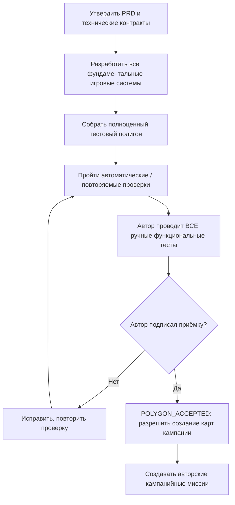

# Обязательный полигон и порядок производства

**Технический нормативный раздел.** Вход: [`08-tech-and-production.md`](../08-tech-and-production.md); правила работы: [`AGENTS.md`](../../AGENTS.md).

## Обязательный порядок производства: PROD-GATE-001

**Статус:** `ОБЯЗАТЕЛЬНОЕ ТРЕБОВАНИЕ АВТОРА` по ответу `P04-Q33`, 2026-11-06. **Не путать** с первоначальным MVP, где первая сюжетная карта предшествовала завершению всех систем.

## Непереставляемый порядок работ

**Запрет для агентов:** ни одна задача по созданию финальных карт кампании и их сюжетному наполнению не должна запускаться до события/статуса `POLYGON_ACCEPTED`, утверждённого автором. Полигон обязан содержать **все планируемые основные механики**, но использует тестовые конфигурации, заглушки и искусственные маршруты; для тестирования НЕ нужны готовые сюжетные карты или художественные финальные ассеты.

## Что должно быть готово перед авторской приёмкой

1. **Город/мета:** территории, здания и перемещения, производственные циклы/офлайн-прогресс, технологии, разблокировки, экономические ресурсы, постоянные улучшения, казармы/мастерская, контракты, сохранение/загрузка и переходы карта–город (в объёме утверждённого PRD).
2. **Боевая сессия:** подготовка, старт, фазы волн, разные точки появления, здоровье нескольких целей, результат, награды, отмена/закрытие, возврат и повтор с первой волны.
3. **Геометрия:** ручные траектории, развилки, перекрёстки, высота, смена полос, группы по ширине, обгон/наложение врагов, разные слоты/размеры/позиции, специальные объекты.
4. **Юниты:** обычные/улучшенные/элитные, герои, наёмники, специальные отряды, призыватели и их виртуальные существа, атаки, смерть, бесплатное воскрешение, полный сброс HP между волнами.
5. **Ловушки и башни:** совместимость со слотами, разные типы/габариты/AoE, расход заряда, ручная платная перезарядка, начисление ресурса убийств, правило продажи разряженной ловушки.
6. **Магия, способности и враги:** применение, откаты, урон, призывы, босс, специфические игровые события и ограничения карты.
7. **Управление и UX:** управление камерой/зумом, HUD и карты выбора, режимы скорости ×1/×2/×3, пауза/автопауза/выключение, выбор объектов, всплывающая информация и бестиарий, результаты.
8. **Надёжность:** ручное/принудительное закрытие, корректность перезапуска, недублирование контрактов и ресурсов, валидность сохранений, QA и производительность.
9. **Граничные случаи:** пустое поле, единственная разряженная ловушка, десятки врагов в одной позиции, повторное воскрешение, смерть призывателя, враг у защищаемой цели, несколько направлений и несколько обороняемых целей, сложность и специальные модификаторы.
10. **Расширяемость:** тестовые конфигурации новых типов объектов/слотов/маршрутов/волны без изменения несвязанных систем; отсутствие ошибки в статистике/результатах при повторе.

**Точные численные/контентные наборы:** задаются P05–P14 и P10. Здесь перечислены категории обязательных проверок, не придуманы конкретные юниты или стоимость.

## Приёмочный артефакт

`06_QA/polygon-acceptance-matrix.md` содержит проверочные сценарии и чеклист. На момент готовности должны существовать: номер проверенной сборки; дата; конфигурация полигона; список тестов со статусами и доказательствами (лог/видео/скриншот при необходимости); список дефектов; подпись/явное подтверждение автора **«ПОЛИГОН ПРИНЯТ»**. До этого gate имеет статус `NOT_ACCEPTED`, даже если автотесты зелёные.

Полигон **не заменяет** тестирование затем создаваемых кампанийных карт: каждая карта дополнительно проходит проверки своих маршрутов, волн, сложности и слотов.

## Пересмотр старого плана разработки

- `MVP-31` и `MVP-50` в прежней редакции предусматривали первую кампанийную миссию до полного завершения всех игровых механик. Это больше не является утверждённым порядком разработки.
- При пересборке плана Codex сначала появятся задачи на каркас и интерфейсы систем, затем задачи на **полный полигон**, затем отдельный milestone с подписью автора, затем задачи на кампанийные карты.
- Архитектуру можно тестировать частями в процессе. Но разрешение на создание настоящих карт кампании даёт **только итоговая функциональная приёмка всего полигона**.
- Бесконечный режим (`P15`) проектируется отдельно. Его уникальные системы/сохранения можно испытать на полигоне до создания финальной карты бесконечного режима; сам режим не подменяется кампанийной логикой.

## Практика UE5

Помимо ручной приёмки, UE5 поддерживает C++ Automation Test Framework и функциональные проверки. Рекомендовано использовать повторяемые тестовые сценарии и автоматические проверки инвариантов, но **они не заменяют подписанную пользователем ручную приёмку**. Проверка конкретных API/плагинов производится на закреплённой версии UE 5.5. Справка: https://dev.epicgames.com/documentation/unreal-engine/API/Runtime/Core/Misc/FAutomationTestFramework?application_version=5.5
